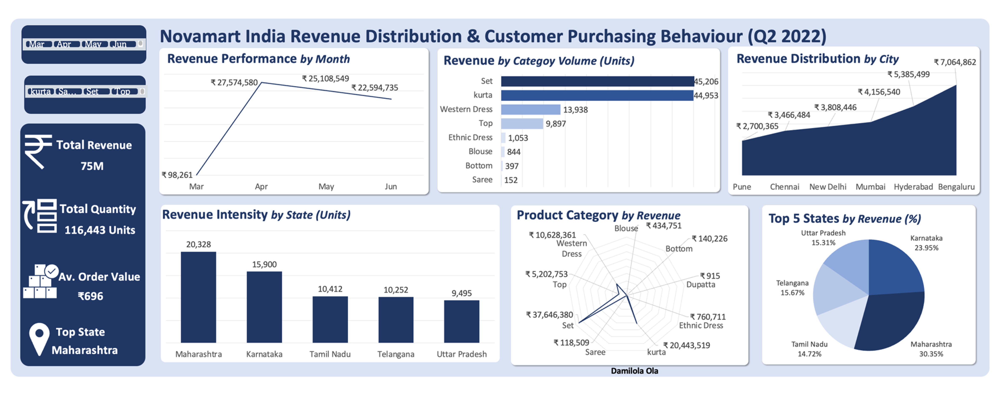

# Novamart India Revenue Distribution & Customer Purchasing Behaviour

## Project Overview

An interactive Excel dashboard analysing Novamart India's revenue distribution and customer purchasing behaviour for Q2 2022. Built as part of my data analytics training with Vephla.

The analysis focuses on monthly revenue performance, product category volume, geographic revenue distribution, state-level purchasing activity, and revenue contribution by product category and state.

## Dashboard

## Objectives
- Track monthly revenue performance
- Compare product categories by volume and revenue
- Identify top cities and states by revenue

## Tools
- Microsoft Excel: data cleaning, pivot tables, pivot charts, slicers

## Key metrics
| Metric | Value |
|---|---|
| Total revenue | ₹75M |
| Units sold | 116,443 |
| Average order value | ₹696 |
| Top state | Maharashtra |
| Top city | Bengaluru (₹7.06M) |

## Key insights
1. Sets drove ₹37.65M, about 50% of total revenue.
2. Sets and kurtas sold similar volumes (45,206 vs 44,953 units), but sets earned about 1.8x more revenue.
3. Revenue peaked in April (₹27.57M) and declined about 18% by June.
4. Bengaluru was the top city, but Maharashtra was the top state (30.35% of top-five revenue).
5. Sarees and dupattas contributed very little revenue.

## Recommendations
- Prioritise stock and promotions for the Set category
- Upsell kurta buyers into sets
- Investigate the April to June revenue decline
- Review the strategy for low-performing categories

## Author

**Damilola Olabode Ogundiran**
